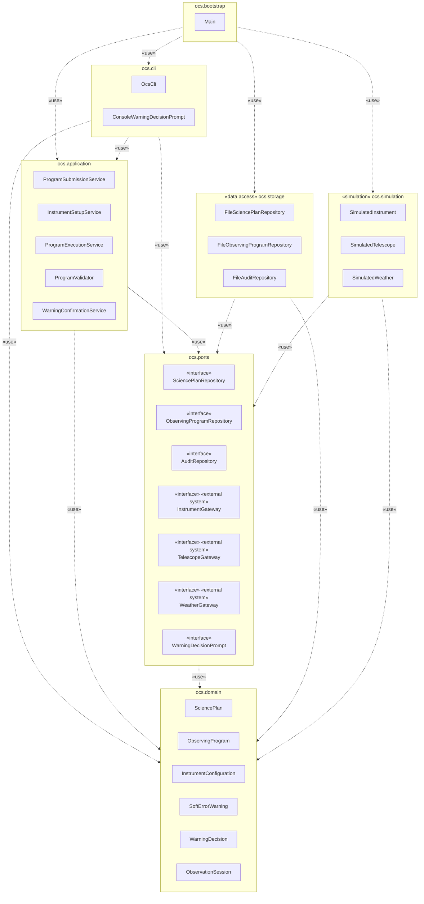
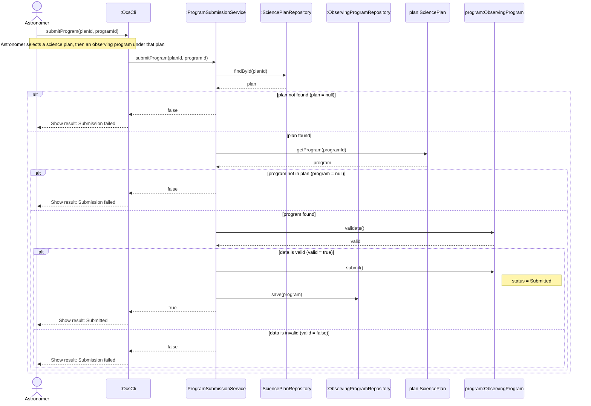
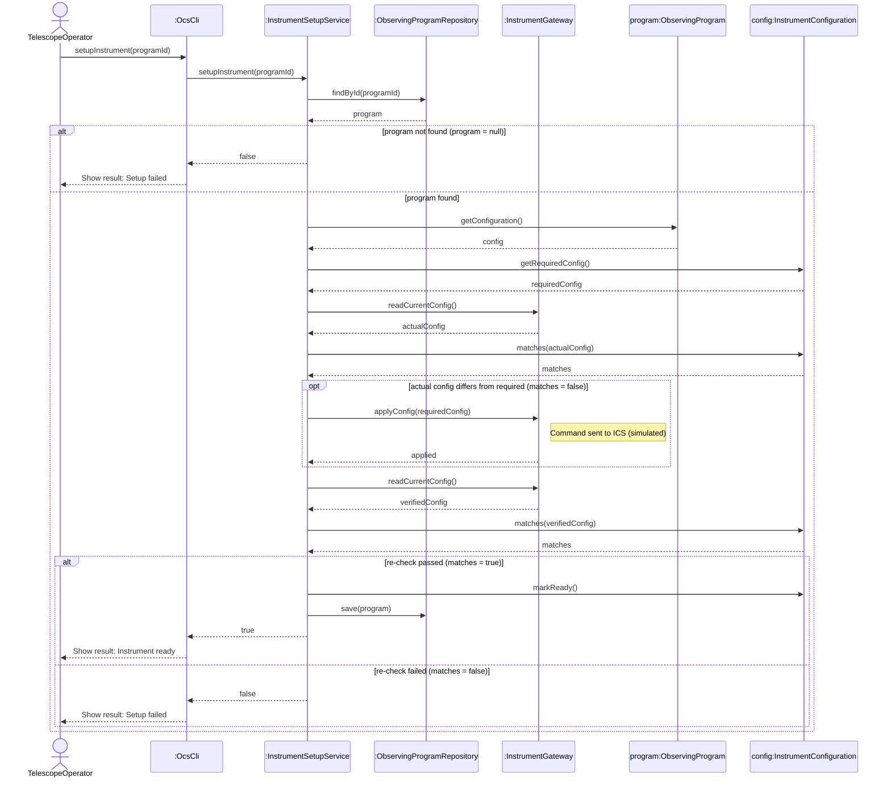
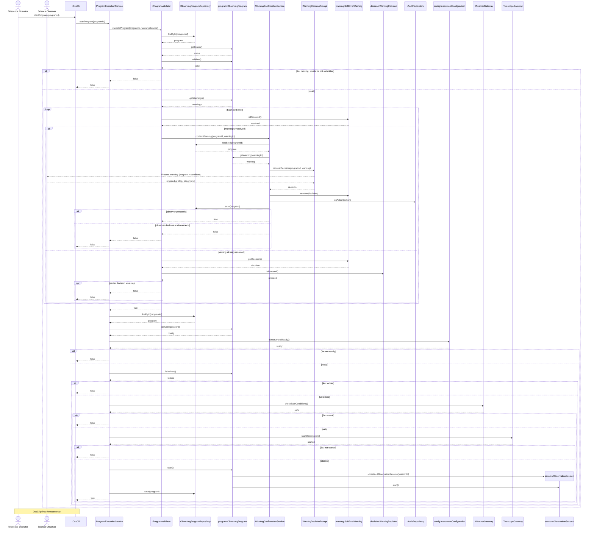
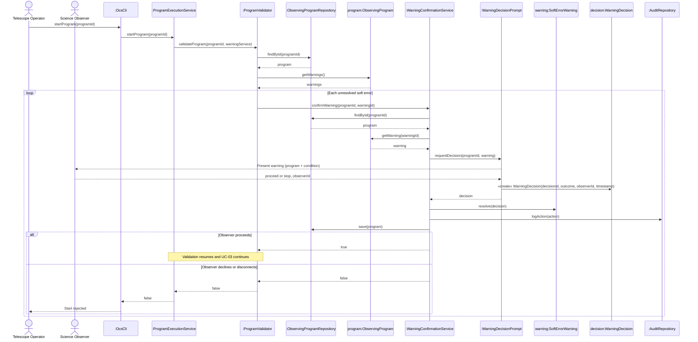

# Chicken bomb D4 Design

## Selected Use Cases

This design covers four use cases from our Phase 1 analysis (D3). Together they take one observing program from submission to the start of its observation.

| No. | Use Case | Primary Actor | Data the use case uses and produces |
|---|---|---|---|
| 1 | UC-04 Submit Observing Program | Astronomer | Reads a `SciencePlan`, finds its `ObservingProgram`, and sets the program's status to Submitted |
| 2 | UC-05 Configure Planned Instrument Setup | Telescope Operator | Reads the submitted `ObservingProgram` and marks its `InstrumentConfiguration` ready |
| 3 | UC-03 Start Observing Program | Telescope Operator | Checks the `ObservingProgram` and its `InstrumentConfiguration`, then creates an `ObservationSession` |
| 4 | UC-01 Confirm Soft-Error Warning | Science Observer | Resolves each `SoftErrorWarning` of the `ObservingProgram` with a `WarningDecision` and records it in the audit log |

**Why we selected these four use cases**

1. **They involve both a science plan and an observing program.** UC-04 Submit Observing Program works on both main classes of the Gemini system: it finds an observing program inside its science plan and submits it. This matches the observing program step of the example flow in the project description (Create Science Plan, Validate Science Plan, Create Observing Program and Execute Science Plan). UC-05, UC-03 and UC-01 then carry the same program on towards execution, the Execute Science Plan end of that flow.
2. **They form one connected flow over shared data.** Each use case works on the observing program that the previous one produced: UC-04 submits it, UC-05 prepares the instrument for it, UC-03 starts it, and UC-01 handles the soft-error warnings that UC-03 raises while it validates the program. All four share `ObservingProgram` and `ObservingProgramRepository`.
3. **They reach every external system through an interface.** UC-05 uses the instrument (`InstrumentGateway`), and UC-03 uses the weather system and the telescope (`WeatherGateway`, `TelescopeGateway`). Each of these interfaces has a simulated version in `ocs.simulation`. All four use cases read and write the data store only through the repository interfaces in `ocs.ports`.
4. **They involve three different actors.** The Astronomer, the Telescope Operator and the Science Observer each drive at least one use case, which shows the OCS as the layer between the user tools and the observatory hardware.
5. **Each one shows a meaningful collaboration.** Every sequence diagram involves at least three classes of our own design, and none of the four is Login. All four were already analysed in Phase 1, so this deliverable refines them rather than adding new analysis.

## 1. Package Diagram

## 2. Design-Level Class Diagram

```mermaid
classDiagram

    namespace ocs.bootstrap {
        class Main {
            +main(args: String[])$ void
        }
    }

    namespace ocs.cli {
        class OcsCli {
            -submissionService : ProgramSubmissionService
            -setupService : InstrumentSetupService
            -executionService : ProgramExecutionService
            -scanner : Scanner
            -output : PrintWriter
            +OcsCli(submissionService: ProgramSubmissionService, setupService: InstrumentSetupService, executionService: ProgramExecutionService, scanner: Scanner, output: PrintWriter)
            +start() void
            +submitProgram(planId: String, programId: String) void
            +setupInstrument(programId: String) void
            +startProgram(programId: String) void
            -execute(words: String[]) boolean
        }
        class ConsoleWarningDecisionPrompt {
            -scanner : Scanner #123;readOnly#125;
            -output : PrintWriter #123;readOnly#125;
            -clock : Clock #123;readOnly#125;
            +ConsoleWarningDecisionPrompt(scanner: Scanner, output: PrintWriter, clock: Clock)
            +requestDecision(programId: String, warning: SoftErrorWarning) WarningDecision
            -decision(observerId: String, proceed: boolean) WarningDecision
        }
    }

    namespace ocs.domain {
        class SciencePlan {
            -planId : String #123;readOnly#125;
            -programs : List~ObservingProgram~ #123;readOnly#125;
            +SciencePlan(planId: String, programs: List~ObservingProgram~)
            +getPlanId() String
            +getProgram(programId: String) ObservingProgram
        }

        class ObservingProgram {
            -programId : String #123;readOnly#125;
            -status : String
            -isLocked : boolean
            -warnings : List~SoftErrorWarning~ #123;readOnly#125;
            -configuration : InstrumentConfiguration #123;readOnly#125;
            -sessions : List~ObservationSession~ #123;readOnly#125;
            +ObservingProgram(programId: String, configuration: InstrumentConfiguration)
            +getProgramId() String
            +getStatus() String
            +validate() boolean
            +submit() void
            +lock() void
            +start() void
            +addWarning(warning: SoftErrorWarning) void
            +getConfiguration() InstrumentConfiguration
            +getWarnings() List~SoftErrorWarning~
            +getWarning(warningId: String) SoftErrorWarning
            +isLocked() boolean
        }

        class InstrumentConfiguration {
            -requiredConfig : String #123;readOnly#125;
            -isReady : boolean
            +InstrumentConfiguration(requiredConfig: String)
            +getRequiredConfig() String
            +matches(actualConfig: String) boolean
            +markReady() void
            +isInstrumentReady() boolean
        }

        class SoftErrorWarning {
            -warningId : String #123;readOnly#125;
            -condition : String #123;readOnly#125;
            -decision : WarningDecision
            +SoftErrorWarning(warningId: String, condition: String)
            +isResolved() boolean
            +resolve(decision: WarningDecision) void
            +getWarningId() String
            +getCondition() String
            +getDecision() WarningDecision
        }

        class WarningDecision {
            -decisionId : String #123;readOnly#125;
            -outcome : String #123;readOnly#125;
            -decidedBy : String #123;readOnly#125;
            -decidedAt : LocalDateTime #123;readOnly#125;
            +WarningDecision(decisionId: String, outcome: String, decidedBy: String, decidedAt: LocalDateTime)
            +getDecisionId() String
            +isProceed() boolean
            +getDecidedAt() LocalDateTime
            +getDecidedBy() String
        }

        class ObservationSession {
            -sessionId : String #123;readOnly#125;
            -status : String
            -startTime : LocalDateTime
            +ObservationSession(sessionId: String)
            +start() void
            +getSessionId() String
            +getStatus() String
            +getStartTime() LocalDateTime
        }
    }

    namespace ocs.application {
        class ProgramSubmissionService {
            -sciencePlanRepo : SciencePlanRepository #123;readOnly#125;
            -programRepo : ObservingProgramRepository #123;readOnly#125;
            +ProgramSubmissionService(sciencePlanRepo: SciencePlanRepository, programRepo: ObservingProgramRepository)
            +submitProgram(planId: String, programId: String) boolean
        }

        class InstrumentSetupService {
            -instrumentGateway : InstrumentGateway #123;readOnly#125;
            -programRepo : ObservingProgramRepository #123;readOnly#125;
            +InstrumentSetupService(instrumentGateway: InstrumentGateway, programRepo: ObservingProgramRepository)
            +setupInstrument(programId: String) boolean
        }

        class ProgramExecutionService {
            -validator : ProgramValidator
            -warningService : WarningConfirmationService
            -telescopeGateway : TelescopeGateway
            -weatherGateway : WeatherGateway
            -programRepo : ObservingProgramRepository
            +ProgramExecutionService(validator: ProgramValidator, warningService: WarningConfirmationService, telescopeGateway: TelescopeGateway, weatherGateway: WeatherGateway, programRepo: ObservingProgramRepository)
            +startProgram(programId: String) boolean
        }

        class ProgramValidator {
            -programRepo : ObservingProgramRepository #123;readOnly#125;
            +ProgramValidator(programRepo: ObservingProgramRepository)
            +validateProgram(programId: String, warningService: WarningConfirmationService) boolean
        }

        class WarningConfirmationService {
            -programRepo : ObservingProgramRepository #123;readOnly#125;
            -auditRepo : AuditRepository #123;readOnly#125;
            -decisionPrompt : WarningDecisionPrompt #123;readOnly#125;
            +WarningConfirmationService(programRepo: ObservingProgramRepository, auditRepo: AuditRepository, decisionPrompt: WarningDecisionPrompt)
            +confirmWarning(programId: String, warningId: String) boolean
        }
    }

    namespace ocs.ports {
        class SciencePlanRepository {
            <<interface>>
            +findById(planId: String) SciencePlan
            +save(plan: SciencePlan) void
        }
        class ObservingProgramRepository {
            <<interface>>
            +findById(programId: String) ObservingProgram
            +save(program: ObservingProgram) void
        }
        class AuditRepository {
            <<interface>>
            +logAction(action: String) void
        }
        class InstrumentGateway {
            <<interface>>
            +readCurrentConfig() String
            +applyConfig(config: String) boolean
        }
        class TelescopeGateway {
            <<interface>>
            +startObservation() boolean
        }
        class WeatherGateway {
            <<interface>>
            +checkSafeConditions() boolean
        }
        class WarningDecisionPrompt {
            <<interface>>
            +requestDecision(programId: String, warning: SoftErrorWarning) WarningDecision
        }
    }

    namespace ocs.storage {
        class FileSciencePlanRepository {
            +FileSciencePlanRepository()
            +findById(planId: String) SciencePlan
            +save(plan: SciencePlan) void
            -dataFile()$ Path
            -readAll()$ Map~String, SciencePlan~
            -writeAll(plans: Map~String, SciencePlan~)$ void
        }
        class FileObservingProgramRepository {
            +FileObservingProgramRepository()
            +findById(programId: String) ObservingProgram
            +save(program: ObservingProgram) void
            -dataFile()$ Path
            -readAll()$ Map~String, ObservingProgram~
            -writeAll(programs: Map~String, ObservingProgram~)$ void
        }
        class FileAuditRepository {
            +FileAuditRepository()
            +logAction(action: String) void
            -auditFile()$ Path
        }
    }

    namespace ocs.simulation {
        class SimulatedInstrument {
            -currentConfig : String
            +SimulatedInstrument()
            +readCurrentConfig() String
            +applyConfig(config: String) boolean
        }
        class SimulatedTelescope {
            +SimulatedTelescope()
            +startObservation() boolean
        }
        class SimulatedWeather {
            +SimulatedWeather()
            +checkSafeConditions() boolean
        }
    }

    namespace java.io {
        class PrintWriter
        class Serializable {
            <<interface>>
        }
    }
    namespace java.util {
        class Scanner
    }
    namespace java.time {
        class Clock
    }

    %% ---------- Bootstrap wiring ----------
    Main ..> OcsCli
    Main ..> ProgramSubmissionService
    Main ..> InstrumentSetupService
    Main ..> ProgramExecutionService
    Main ..> ProgramValidator
    Main ..> WarningConfirmationService
    Main ..> FileSciencePlanRepository
    Main ..> FileObservingProgramRepository
    Main ..> FileAuditRepository
    Main ..> SimulatedInstrument
    Main ..> SimulatedTelescope
    Main ..> SimulatedWeather
    Main ..> ConsoleWarningDecisionPrompt
    Main ..> Scanner
    Main ..> PrintWriter
    Main ..> Clock

    %% ---------- CLI -> Application ----------
    OcsCli --> "1" ProgramSubmissionService : -submissionService
    OcsCli --> "1" InstrumentSetupService : -setupService
    OcsCli --> "1" ProgramExecutionService : -executionService
    OcsCli --> "1" Scanner : -scanner
    OcsCli --> "1" PrintWriter : -output

    %% ---------- Domain ----------
    SciencePlan "1" o--> "1..*" ObservingProgram : -programs
    ObservingProgram "1" *--> "0..*" SoftErrorWarning : -warnings
    ObservingProgram "1" o--> "0..1" InstrumentConfiguration : -configuration
    ObservingProgram "1" *--> "0..*" ObservationSession : -sessions
    SoftErrorWarning "1" --> "0..1" WarningDecision : -decision

    %% ---------- Application -> Ports / Services ----------
    ProgramSubmissionService --> "1" SciencePlanRepository : -sciencePlanRepo
    ProgramSubmissionService --> "1" ObservingProgramRepository : -programRepo
    InstrumentSetupService --> "1" InstrumentGateway : -instrumentGateway
    InstrumentSetupService --> "1" ObservingProgramRepository : -programRepo
    ProgramExecutionService --> "1" ProgramValidator : -validator
    ProgramExecutionService --> "1" WarningConfirmationService : -warningService
    ProgramExecutionService --> "1" TelescopeGateway : -telescopeGateway
    ProgramExecutionService --> "1" WeatherGateway : -weatherGateway
    ProgramExecutionService --> "1" ObservingProgramRepository : -programRepo
    ProgramValidator --> "1" ObservingProgramRepository : -programRepo
    WarningConfirmationService --> "1" ObservingProgramRepository : -programRepo
    WarningConfirmationService --> "1" AuditRepository : -auditRepo
    WarningConfirmationService --> "1" WarningDecisionPrompt : -decisionPrompt
    ConsoleWarningDecisionPrompt --> "1" Scanner : -scanner
    ConsoleWarningDecisionPrompt --> "1" PrintWriter : -output
    ConsoleWarningDecisionPrompt --> "1" Clock : -clock

    %% Dependency between application services
    ProgramValidator ..> WarningConfirmationService

    %% ---------- Realizations ----------
    FileSciencePlanRepository ..|> SciencePlanRepository
    FileObservingProgramRepository ..|> ObservingProgramRepository
    FileAuditRepository ..|> AuditRepository
    SimulatedInstrument ..|> InstrumentGateway
    SimulatedTelescope ..|> TelescopeGateway
    SimulatedWeather ..|> WeatherGateway
    ConsoleWarningDecisionPrompt ..|> WarningDecisionPrompt
    SciencePlan ..|> Serializable
    ObservingProgram ..|> Serializable
    InstrumentConfiguration ..|> Serializable
    SoftErrorWarning ..|> Serializable
    WarningDecision ..|> Serializable
    ObservationSession ..|> Serializable

    %% ---------- Notes: roles / design patterns ----------
    note for Main "Role: Composition Root (wires all dependencies)"
note for OcsCli "Role: Entry point. UC-04 Submit (Astronomer), UC-05 Configure and UC-03 Start (Telescope Operator). Pattern: Constructor-based Dependency Injection"
    note for SciencePlan "Role: Entity (Aggregate)"
    note for ObservingProgram "Role: Entity (Aggregate Root)"
    note for InstrumentConfiguration "Role: Entity"
    note for SoftErrorWarning "Role: Entity"
    note for WarningDecision "Role: Value Object (record of decision)"
    note for ObservationSession "Role: Entity"
    note for ProgramSubmissionService "Role: Application Service (UC-04)"
    note for InstrumentSetupService "Role: Application Service (UC-05)"
    note for ProgramExecutionService "Role: Application Service (UC-03)"
    note for ProgramValidator "Role: Application Service (Validate Program)"
    note for WarningConfirmationService "Role: Application Service (UC-01)"
    note for SciencePlanRepository "Role: Port (Repository)"
    note for ObservingProgramRepository "Role: Port (Repository)"
    note for AuditRepository "Role: Port (Repository)"
    note for InstrumentGateway "Role: Port (external system)"
    note for TelescopeGateway "Role: Port (external system)"
    note for WeatherGateway "Role: Port (external system)"
    note for WarningDecisionPrompt "Role: Port (CLI actor interaction)"
    note for ConsoleWarningDecisionPrompt "Role: Adapter (CLI actor interaction)"
    note for FileSciencePlanRepository "Role: Adapter (Repository)"
    note for FileObservingProgramRepository "Role: Adapter (Repository)"
    note for FileAuditRepository "Role: Adapter (Repository)"
    note for SimulatedInstrument "Role: Adapter (simulated external system)"
    note for SimulatedTelescope "Role: Adapter (simulated external system)"
    note for SimulatedWeather "Role: Adapter (simulated external system)"
```

## 3. Design-Level Sequence Diagrams

### 3.1 UC-04 Submit Observing Program

### 3.2 UC-05 Configure Planned Instrument Setup

### 3.3 UC-03 Start Observing Program

### 3.4 UC-01 Confirm Soft-Error Warning

## 4. Revised Use Case Descriptions

### 4.1 UC-04 Submit Observing Program

| Use Case ID: | UC-04 |
|---|---|
| Use Case Name: | Submit Observing Program |
| Process Owner: | Astronomer |
| Last Updated By: | Madhuri Singh |
| Date Created: | 15/09/2026 |
| Date Last Updated: | 09/11/2026 |
| Business Actor: | Astronomer |
| Description: | Allows an Astronomer to submit an observing program that belongs to a science plan for further processing and scheduling. |
| Trigger: | The Astronomer has completed an observing program under a science plan and chooses to submit it. |
| Relationship: | Association: Astronomer |
| Preconditions: | 1. The Astronomer is logged in. 2. A science plan exists. 3. An observing program has been created under that science plan. |
| Postconditions: | 1. On success, the observing program, which belongs to the selected science plan, has status Submitted and is stored in the system. 2. On failure, the status of the observing program is unchanged. |
| Performance Goal: | The system shall submit the observing program and display the submission result within 2 seconds. |
| Basic Workflow: | 1. The Astronomer selects a science plan and an observing program under that plan, and chooses Submit Observing Program. 2. The system retrieves the selected science plan. 3. The system finds the selected observing program in that science plan. 4. The system checks that the observing program contains the required information (its instrument configuration). 5. The system sets the status of the observing program to Submitted and stores the program. 6. The system displays the submission result "Submitted". |
| Alternative Workflow: | **2a. Science Plan Not Found:** If the selected science plan does not exist, the system displays "Submission failed". The use case ends.  **3a. Program Not in Science Plan:** If the selected observing program does not belong to that science plan, the system displays "Submission failed". The use case ends.  **4a. Incomplete or Invalid Program Information:** If the observing program is missing required information, the system keeps the program status unchanged and displays "Submission failed". The use case ends. |
| Category: | User-initiated |
| Risks: | Incomplete or invalid observing program information may prevent successful submission. |
| Possibilities: | The system could provide validation feedback before submission to help the Astronomer correct missing or invalid information. |

*Revised from Phase 1:* the old 2a is split into 2a (plan not found) and 3a (program not in plan), and the old 4a and 4b are merged into 4a, because the design checks the plan, the program and the program data one after another, with a single `validate()` for the data. The old 5a (connection error) is removed because the design does not model it. The old precondition 4 is removed because step 4 now checks it.

### 4.2 UC-05 Configure Planned Instrument Setup

| Use Case ID: | UC-05 |
|---|---|
| Use Case Name: | Configure Planned Instrument Setup |
| Process Owner: | Gemini Science Operations |
| Last Updated By: | Nattanan Jumparuang |
| Date Created: | 15/09/2026 |
| Date Last Updated: | 09/11/2026 |
| Business Actor: | Telescope Operator |
| Description: | Allows the Telescope Operator to configure the instrument physically (filter, grating, detector mode, etc.) prior to the execution of a program, so that the Start Observing Program configuration check is satisfied. The operator runs it before Start Observing Program (UC-03), or after UC-03 reports that the instrument is not ready. |
| Trigger: | The operator chooses a program and starts setup, or Start Observing Program (UC-03) reports that the instrument is not ready. |
| Relationship: | Association: Telescope Operator, Instrument Control System (ICS) |
| Preconditions: | 1. Operator login is successful. 2. The observing program has been submitted (UC-04) and specifies its required instrument configuration. 3. The instrument is not locked with any exposures. |
| Postconditions: | 1. Configuration of the instrument conforms to the requirements of the program. 2. The configuration is recorded relative to the program. 3. The instrument is in the ready state (or fails and remains in the last good state). |
| Performance Goal: | Configuration test done within 5 seconds. |
| Basic Workflow: | 1. The operator selects the program and starts setup. 2. The system retrieves the program and its required instrument configuration. 3. The system reads the current configuration from the ICS and checks it against the required one. 4. The system sends the required configuration to the ICS. 5. The ICS makes the changes; the system reads the configuration from the ICS again and verifies it. 6. The system marks the instrument configuration ready, records it with the program, and displays "Instrument ready". |
| Alternative Workflow: | **2a. Program Not Found:** If the program does not exist or has not been submitted, the system displays "Setup failed". The use case ends.  **3a. Already Matches:** If the current configuration already matches the required one, the system skips step 4 and continues at step 5.  **5a. Verification Unsuccessful:** If the configuration still does not match, the system does not mark the instrument ready, keeps the previous state, and displays "Setup failed". The operator may run setup again. The use case ends. |
| Category: | Observation Management |
| Risks: | False "successful" report of hardware; concurrent operators at odds using the same machine; hurried verification due to time constraints. |
| Possibilities: | Daytime pre-stage/config verifications; re-usable config templates; closed-loop sensor verifications. |

*Revised from Phase 1:* step 3 is now done by the system instead of the operator, because the design sends the configuration to the ICS. The old 3a now continues to verification, as the `opt` fragment does. The old 4a (calibration), 5a (notify Support Staff) and the Support Staff actor are removed because the design does not include them. The old 6a becomes 5a.

### 4.3 UC-03 Start Observing Program

| Use Case ID: | UC-03 |
|---|---|
| Use Case Name: | Start Observing Program |
| Process Owner: | Gemini Science Operations |
| Last Updated By: | Phoonyaphat Junsiri, Barameeporn Niyomtrong |
| Date Created: | 15/09/2026 |
| Date Last Updated: | 09/11/2026 |
| Business Actor: | Telescope Operator |
| Description: | This use case describes how the Telescope Operator starts execution of a submitted observing program. Before the observation starts, the system validates the program, checks that the instrument is ready, that the program is not locked and that the weather is safe, and then commands the telescope to start observing. |
| Trigger: | The telescope operator commands the system to begin observing. Type: External |
| Relationship: | Association: Telescope Operator, Weather Monitoring System, Telescope Control System Include: Validate Program, Check Instrument Configuration Extend: None (Validate Program is extended by Confirm Soft-Error Warning, UC-01) Generalization: None |
| Preconditions: | 1. Telescope operators must be authenticated/logged in first. 2. The observing program has been submitted (UC-04). |
| Postconditions: | 1. The observing program has status Running and is locked, and a new observation session for it has been created and started. 2. The program, with its observation session, is stored in the system. 3. If any check fails, the program is not started and its status is unchanged. |
| Performance Goal: | 1. The system shall begin executing a validated observing program within 2 seconds of the Telescope Operator's start command. 2. Instrument configuration checks (Validate Program, Check Instrument Configuration) shall complete within 5 seconds before execution begins. Time spent waiting for the Science Observer's decision in UC-01 is excluded. |
| Basic Workflow: | 1. The Telescope Operator selects a submitted observing program and commands the system to start it. 2. The system validates the program: the program must exist, have status Submitted and contain the required information (see 2a, 2b). 3. The system checks that the instrument configuration of the program is ready. 4. The system checks that the program is not locked. 5. The system checks that the Weather Monitoring System indicates safe observing conditions. 6. The system commands the telescope to start the observation. 7. The system sets the program status to Running, locks the program, creates and starts a new observation session, and stores the program. 8. The system displays the start result. |
| Alternative Workflow: | **2a — Program fails validation** If the program does not exist, does not have status Submitted, or is missing required information, the system does not start it and displays that the start was rejected. The use case ends.  **2b — Soft error detected during validation** For each soft-error warning that is not yet resolved, Validate Program is extended by Confirm Soft-Error Warning (UC-01). If the Science Observer proceeds on every warning, validation completes and the flow continues at step 3. If the Science Observer declines or does not respond, or a warning was already declined in an earlier start, validation fails and the flow continues as in 2a.  **3a — Instrument not ready** If the instrument configuration of the program is not ready, the system does not start the program and displays that the start was rejected. The Telescope Operator runs Configure Planned Instrument Setup (UC-05) and then starts the program again. The use case ends.  **4a — Program locked** If the program is locked, the system does not start it and displays that the start was rejected. The use case ends.  **5a — Unsafe weather conditions** If the Weather Monitoring System reports unsafe conditions, the system does not start the program and displays that the start was rejected. The Telescope Operator may wait and retry once conditions improve. The use case ends.  **6a — Telescope fails to start the observation** If the telescope does not start the observation, the system does not mark the program as started and displays that the start was rejected. The use case ends. |
| Category: | Observation Management |
| Risks: | 1. The program fails to validate &nbsp;&nbsp;&nbsp;&nbsp;a. If the program fails to validate the observing program may not start 2. The instrument is not properly configured. &nbsp;&nbsp;&nbsp;&nbsp;a. leads to failure to start the observing program. 3. Unsafe weather conditions. &nbsp;&nbsp;&nbsp;&nbsp;a. the system prevent the observation from starting and displays a warning 4. The start command don't run properly &nbsp;&nbsp;&nbsp;&nbsp;a. leads to failure to start the observing program. |
| Possibilities: | 1. Pre observation summary checklist &nbsp;&nbsp;&nbsp;&nbsp;a. Show all the pre-observation task as a checklist 2. Predictive weather buffer &nbsp;&nbsp;&nbsp;&nbsp;a. To show a predictive weather in the future. 3. Auto-resume after transient lock conflicts &nbsp;&nbsp;&nbsp;&nbsp;a. Instead of let the telescope operator manually retry the system if the subsystem lock make it auto |

*Revised from Phase 1:* Interactive Mode (old step 7, alternatives 7a, 7b and 7c, postcondition 2 and performance goal 2) and the include and extend use cases that the design does not implement are removed. The lock check is now a check on the program itself and comes before the weather check, as in the sequence diagram, so it becomes step 4 and alternative 4a, and the weather check becomes step 5 and alternative 5a. Preconditions 3, 4 and 5 are removed because steps 3, 4 and 5 now check them. The telescope and weather systems are listed as actors because the design reaches them through `TelescopeGateway` and `WeatherGateway`.

### 4.4 UC-01 Confirm Soft-Error Warning

| Use Case ID: | UC-01 |
|---|---|
| Use Case Name: | Confirm Soft-Error Warning |
| Process Owner: | Gemini Science Operations |
| Last Updated By: | Woraneti |
| Date Created: | 15/09/2026 |
| Date Last Updated: | 09/11/2026 |
| Business Actor: | Science Observer |
| Description: | During program validation the system distinguishes between hard physical errors and soft errors. Hard errors — such as a target below the horizon or a filter not mounted in the wheel — are rejected automatically and never reach this use case. Soft errors — such as observing at a high airmass where image quality degrades — are not rejected: the system raises a warning and the Science Observer decides whether the observation proceeds as planned or stops. |
| Trigger: | Program validation detects one or more soft errors in an observing program that is being prepared for execution. Type: External |
| Relationships: | Association: Science Observer Include: None Extend: Validate Program (this use case extends Validate Program) Generalization: None |
| Preconditions: | 1. The Science Observer is logged in and holds a role authorised to act on the program. 2. The system is at the Observing operational level. 3. Validate Program is executing for an observing program that the Telescope Operator is starting (UC-03). 4. The program has at least one soft-error warning that is not yet resolved. 5. Validation has detected no hard physical errors — a program containing a hard error is rejected before reaching this use case. |
| Postconditions: | 1. The decision, the identity of the decision maker, and an exact timestamp are recorded and retained permanently. 2. If the observer proceeds: control returns to Validate Program, which completes and allows the program to continue toward execution. 3. If the observer does not proceed: validation fails, the program is not started and keeps its status, and the Telescope Operator is told that the start was rejected. |
| Performance Goal: | The observer's confirmation is a command to the system and must be accepted or rejected within 2 seconds, before the resulting action occurs. |
| Basic Workflow: | 1. Validate Program reaches the extension point at which an unresolved soft-error warning has been found. 2. The system presents the soft-error warning to the Science Observer, identifying the program and the condition that raised it. 3. The Science Observer reviews the warning against the scientific goals of the program. 4. The Science Observer enters their observer ID and confirms that the observation should proceed. 5. The system creates a decision with the outcome, the observer ID and the timestamp, resolves the warning with it, records it in the audit log, and stores the program. 6. The system returns control to Validate Program, which completes validation. |
| Alternative Workflow: | **2a. More than one soft error:** If the program has more than one unresolved soft-error warning, the system repeats steps 2–5 for each warning, one at a time. Validation completes only when the observer proceeds on every warning.  **4a. Observer does not proceed:** If the Science Observer decides not to proceed, the system records a Stop decision in the same way as step 5. Validation fails, the program is not started, and the Telescope Operator sees that the start was rejected. The use case ends.  **4b. No decision:** If the Science Observer gives no observer ID or no answer, for example because the connection is lost, the system records a Stop decision (with NO_RESPONSE as the decision maker when no observer ID was given) and continues as in 4a. |
| Category: | Observation Management |
| Risks: | 1. The observer approves a warning under time pressure (the directorate's usable-night KPI) without fully weighing the scientific trade-off, leading to degraded data that is only discovered during analysis. 2. Warning fatigue — if soft-error warnings recur often for common conditions (e.g. routine high-airmass targets), observers may confirm reflexively without reading the specific condition each time. 3. The system's timeout for "too long to decide" is not specified by the PO; if the team sets it too short, valid decisions get cut off; if too long, it conflicts with the directorate's stated priority of minimizing idle time. 4. If the team's proposal is "confirm all warnings at once" for a program with multiple soft errors, an observer may miss one specific issue buried among several. |
| Possibilities: | 1. Let observers set default responses for well-understood, recurring warning types (e.g. "always proceed on airmass warnings above a given threshold for this program"), subject to periodic review. 2. Notify the remote Astronomer of the decision after the fact, even though they cannot act on it directly — keeps the program owner informed. 3. Track each observer's warning-decision history to support the audit and training use cases already in D1 § Logging. 4. A severity-scaled timeout (a marginal soft warning gets less waiting time than one closer to the hard-error boundary). |

*Revised from Phase 1:* steps 4 and 5 and the alternatives now follow the sequence diagram. Warnings are confirmed one at a time in a loop, the observer enters an observer ID with each decision, and each decision is created with a timestamp, resolves the warning, is written to the audit log and is saved with the program. A missing answer is recorded as a Stop decision. Postcondition 3 now matches the design: a program whose warning is declined is rejected, and the Telescope Operator is told so.
